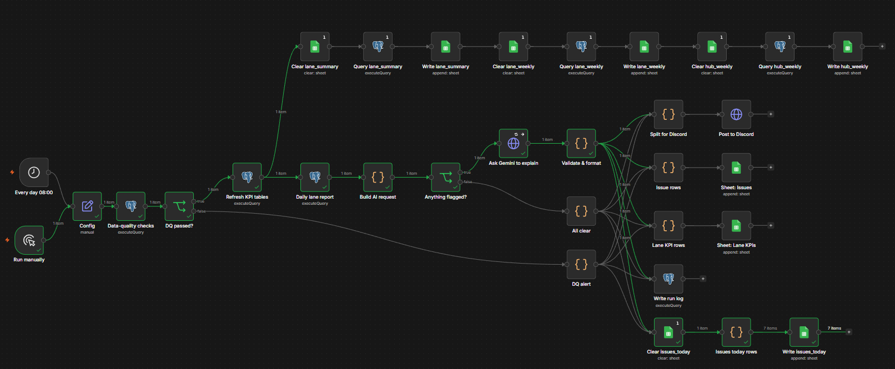
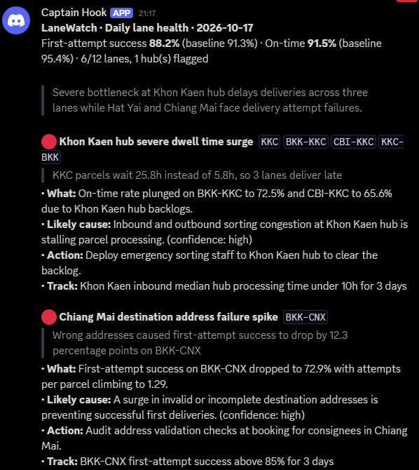
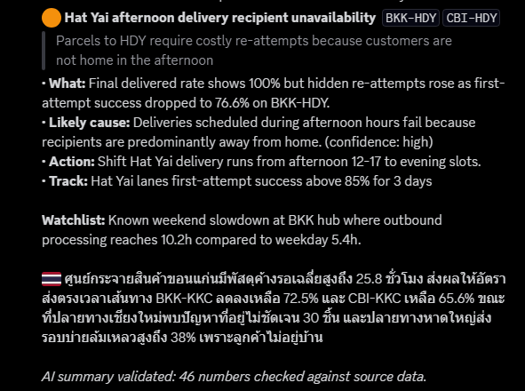
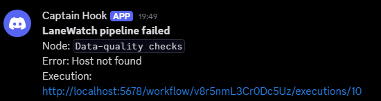
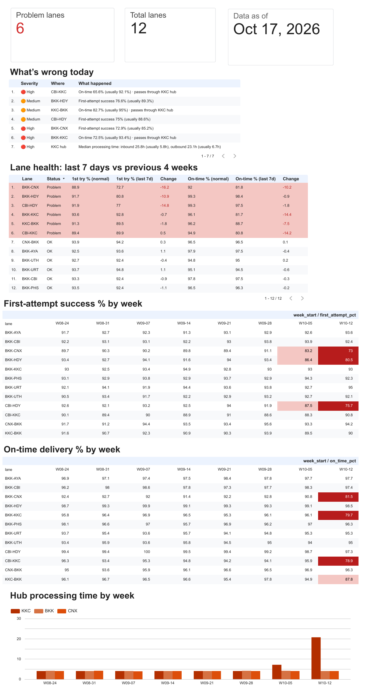
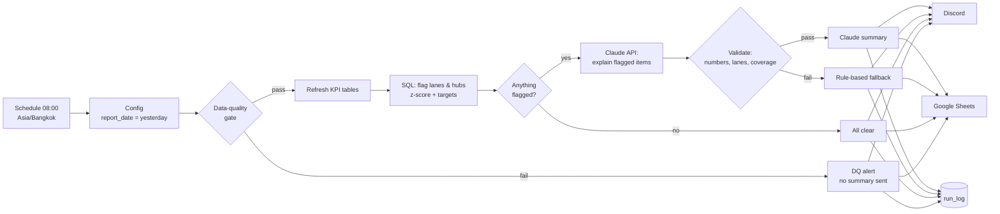

# LaneWatch: automated lane health monitoring for last-mile logistics

**Every morning, LaneWatch checks yesterday's delivery data, finds the lanes and hubs that are underperforming, asks Claude to explain *why*, verifies every number Claude writes, and posts a 2-minute summary for the operations team.**

Built with **n8n · Claude API · PostgreSQL · Google Sheets · Looker Studio**, on synthetic data for a 9-hub Thai delivery network.

---

## The result

On synthetic data with four problems hidden in it, the pipeline found all four without being told where to look:

| Planted problem | What LaneWatch reported |
|---|---|
| Khon Kaen hub slowly getting slower | One **hub** issue covering 3 lanes (not 3 separate lane alerts). The hub alert fired **3 days before** lane SLA breaches showed up. |
| Hat Yai: afternoon delivery failures | Afternoon (12-17) fail rate 38.0% vs 13.5% normally, almost all "customer not available" |
| BKK-CNX: first attempts failing, rescued by re-attempts | First-attempt success 72.9% vs 85.2%, while **final delivered rate still showed 100%**. A delivered-rate dashboard would show nothing wrong. |
| Bangkok SOC weekend backlog | Put on the watchlist as a recurring pattern, not raised as an incident every weekend |

In a 31-day backtest, normal days were quiet: 2 medium alerts in the 15 days before the problems started. See [`samples/backtest_2026-09-17_to_2026-10-17.txt`](samples/backtest_2026-09-17_to_2026-10-17.txt).

A sample of the daily message is in [`samples/message_validated.txt`](samples/message_validated.txt). It was generated by the test suite from a hand-written example AI response, so its number count (81) differs from the live Gemini run shown below (46).

---

## What it looks like

**The n8n workflow.** It runs every day at 08:00. The top row rewrites the dashboard tabs, the middle row runs the analysis, and the right side writes to Discord, Google Sheets and the run log.



**The daily Discord message (live Gemini run).** All 46 numbers in it were checked against the source data. Each run writes different text, so the count changes from run to run.

<p>
  
  
</p>

**If the pipeline itself breaks,** for example when the database is unreachable, a separate error workflow posts this alert:



**The Looker Studio dashboard.** It is refreshed by the workflow every morning. The "What's wrong today" table is **facts only**: code writes every cell straight from the SQL results, and no AI text appears in it. The AI's explanations stay in Discord, clearly separated from the data.



---

## Skills demonstrated

| Skill | Where it is in this project |
|---|---|
| Build automated workflows with n8n connecting data, sheets and Claude | `n8n/lanewatch_daily.json`: Postgres → Claude or Gemini API → Google Sheets + Discord |
| Functional gap analysis: flag bottlenecks and explain why lanes/hubs underperform | `sql/05_lane_report.sql` flags; `prompts/system_prompt.md` explains, using *where / why / when* evidence |
| Data pipeline monitoring | Data-quality gate (`sql/04_dq_checks.sql`), AI-output validation, `run_log` table, error workflow |
| Track SFR, lead time compliance, hub-to-hub processing speed | `sql/03_views.sql`: first-attempt success, on-time %, hub dwell P50/P90, linehaul time |
| Optimize lane performance with simple control metrics | Every issue comes with a `control_metric` the regional team can track daily |
| Dashboards / tracking sheets | Google Sheets "Lane KPIs" + "Issues" tabs → Looker Studio |
| Thai + English communication | Every summary includes a Thai version for regional teams |

---

## Architecture



### Four design decisions (the interesting part)

**1. SQL detects, Claude explains.** Deciding *what is abnormal* is done with plain, testable SQL rules. Claude only receives flagged items plus evidence, and its job is to explain them and group them by root cause. This makes detection reproducible and keeps the LLM out of the part that has to be exactly right.

**2. Flags need statistical *and* practical significance.** A lane is flagged when today is at least 3.5 standard errors below its 28-day baseline **and** at least 6 percentage points worse, or below target and clearly below baseline. Small lanes have noisy daily rates; a plain "below 85%" rule would page people on noise. All thresholds live in a `kpi_targets` table, so ops can tune them without touching the workflow.

**3. Never summarise bad data.** Before any analysis, six checks run: freshness, volume vs the same weekday, duplicates, null keys, unknown lanes, and impossible timestamps. If any fail, the team gets an alert listing the failed checks instead of a confident summary built on a half-loaded feed. To try it, run `--bad-data` (see [`samples/message_dq_alert.txt`](samples/message_dq_alert.txt)).

**4. Every number Claude writes is checked.** The `Validate & format` node extracts every number from Claude's answer and checks it exists in the data Claude was given. It also checks that every lane code is real and that every flagged lane and hub is explained. If anything fails, or the API is down, the team gets a rule-based summary that is clearly labelled as such ([`samples/message_rejected_fallback.txt`](samples/message_rejected_fallback.txt)). The prompt tells Claude it will be checked and forbids calculating new numbers.

### KPI definitions

| KPI | Definition | Keyed on |
|---|---|---|
| First-attempt success rate (SFR) | Successful 1st attempts ÷ 1st attempts | Attempt day |
| Lead time compliance (on-time %) | Delivered by end of `created_date + sla_days` ÷ delivered | Delivery day |
| Final delivered rate | Delivered ÷ parcels closed (delivered or returned after 3 attempts) | Close day |
| Attempts per parcel | Attempts ÷ parcels closed. Rising = re-attempt cost | Close day |
| Hub processing time (dwell) | `out_at - in_at` at a hub, P50 and P90, inbound and outbound | Hub departure day |
| Linehaul time | `dest_in_at - origin_out_at`, P50 | Arrival day |

Every metric is keyed on the day the **event** happened, so "yesterday" is always complete. Grouping by creation date instead would make recent days look artificially good, because their slow parcels haven't arrived yet.

**The re-attempt trap.** *Final delivered rate* and *first-attempt success* tell different stories. On BKK-CNX, final delivered stayed at 100% while first-attempt success fell 12.3pp: couriers were quietly absorbing the problem with extra trips (1.29 attempts per parcel vs 1.15). This project monitors both on purpose.

---

## Quick start (about 15 minutes)

You need Docker Desktop, Python 3.10+ with `numpy` (+ `tzdata` on Windows), an Anthropic API key (or a free Gemini key), a Google account, and optionally a Discord server.

```bash
# 1. Generate 60 days of data ending yesterday
pip install numpy tzdata    # tzdata is needed on Windows
python generator/generate_data.py

# 2. Start Postgres (loads the data automatically) + n8n
docker compose up -d
# n8n UI: http://localhost:5678
```

**3. Import the workflows in n8n.** Go to *Workflows → Import from File* and import `n8n/lanewatch_error_alert.json`, then `n8n/lanewatch_daily.json`.

**4. Create credentials and select them on the nodes:**

| Credential | Settings | Used by |
|---|---|---|
| Postgres | host `postgres`, db `lanewatch`, user `lane`, password `lane` | all Postgres nodes |
| Header Auth | name `x-api-key`, value = your Anthropic API key | *Ask Claude to explain* |
| Google Sheets OAuth2 | your Google account | *Sheet:* nodes |

**5. Create the Google Sheet.** Make one Google Sheet with two tabs:

- **Issues**, with header row: `report_date, severity, scope, affected, title, what_happened, likely_cause, confidence, suggested_action, control_metric, source`
- **Lane KPIs**, with header row: `report_date, lane, flagged, severity, first_attempts, first_attempt_success_pct, lead_time_compliance_pct, final_delivered_rate_pct, attempts_per_parcel`

Then paste the Sheet ID into both *Sheet:* nodes.

**6. Finish the setup and run it.** Open *Workflow settings → Error workflow* and choose **LaneWatch · Error alert**. Then click **Run manually**.

**Discord:** in your server, open *Channel settings → Integrations → Webhooks → New Webhook → Copy Webhook URL*, and paste it into `discord_webhook_url` in the **Config** node (and into *Alert on Discord* in the error workflow). Long summaries are split into several messages automatically, because Discord allows 2,000 characters per message. To use email or Telegram instead, swap *Post to Discord* for that node; they all read the same `message_text` field.

**Free option:** `n8n/lanewatch_daily_gemini.json` is the same workflow using Google's Gemini API (free tier). Set Header Auth `x-goog-api-key` on *Ask Gemini to explain*. Same prompt, same validator.

### Demo the data-quality gate
```bash
./scripts/reload.sh --bad-data   # corrupts yesterday's feed, then run the workflow: you get an alert, not a summary
./scripts/reload.sh              # back to clean data
```

### Model
The model is set in the **Config** node (`ai_model`). Any current Claude model works; check the [models overview](https://docs.claude.com/en/docs/about-claude/models/overview) for names.

---

## Dashboard (Looker Studio)

Every morning, after the data passes the quality gate, the workflow rewrites three tabs in the Google Sheet (top row of nodes on the canvas). Looker Studio reads them, so the dashboard is always current:

| Tab | Query | Used for |
|---|---|---|
| `lane_summary` | `sql/dashboard/lane_summary.sql` | Table: last 7 days vs the 4 weeks before, per lane, with a Problem/OK status |
| `lane_weekly` | `sql/dashboard/lane_weekly.sql` | Two heatmap tables (lane × week): first-attempt success and on-time % |
| `hub_weekly` | `sql/dashboard/hub_weekly.sql` | Hub processing time per week |

Weekly numbers instead of daily on purpose: daily rates on small lanes jump around, and the weekly view shows real shifts at a glance. Problem cells are highlighted with conditional formatting (first-attempt below 88%, on-time below 90%).

Before the first run, create the three tabs with a header row each (copy the first line of the matching CSV in `samples/`).

---

## Tests

```bash
node tests/test_code_nodes.js
```

This runs the n8n Code-node JavaScript outside n8n against real query output. 13 tests cover:

- A grounded summary passes.
- An invented ratio ("4.4x"), a fake lane and a missing lane are all rejected.
- The fallback covers every flagged item.
- An API error doesn't crash the workflow, for both Claude and Gemini.
- Markdown-fenced JSON and Gemini's response format are accepted.
- The all-clear and DQ-alert paths work.
- Discord messages are split under 2,000 characters without losing text.
- The dashboard's "What's wrong today" rows contain only numbers that come from the SQL output, and they stay identical whether or not the AI passed validation.

```bash
python scripts/backtest.py --start 2026-09-17 --end 2026-10-17
```
This replays the detection rules for every day and shows when each problem was first caught.

`samples/example_claude_response.json` is an example of a response that follows the prompt. It is used to test the validator. Your live runs will produce their own.

---

## Project structure

```
generator/generate_data.py     synthetic parcels + attempts with 4 planted problems (--bad-data option)
sql/01_schema.sql              raw tables, kpi_targets, run_log
sql/02_load.sql                CSV load
sql/03_views.sql               KPI tables (materialized views)
sql/04_dq_checks.sql           data-quality gate
sql/05_lane_report.sql         detection + evidence → one JSON payload
sql/06_refresh.sql             refresh KPI tables
prompts/system_prompt.md       Claude instructions + output schema
n8n/code/*.js                  Code-node source (tested)
n8n/build_workflow.py          builds the workflow JSON from sql/, prompts/, n8n/code/
n8n/lanewatch_daily.json       ← import this
n8n/lanewatch_error_alert.json ← and this
tests/test_code_nodes.js       validator + formatter tests
scripts/backtest.py            replay detection over a date range
scripts/reload.sh              regenerate + reload data
samples/                       real outputs: payload, chat messages, DQ results, backtest, dashboard CSVs
```

If you edit SQL, the prompt or JS, run `python n8n/build_workflow.py` to rebuild the workflow JSON.

## Limitations

The detection thresholds were tuned on the same synthetic data that contains the planted problems, so they fit this dataset well by design. On real data they would need calibrating. The `kpi_targets` table, which stores the thresholds outside the code, and the planned feedback loop below are designed for that.

## What I would add next
- **Dashboard history:** the three dashboard tabs are rewritten daily; keeping dated snapshots would let the team see how the picture changed.
- **Weekly deep dive:** the same pipeline over 7 days vs the previous 7, sent on Monday mornings.
- **Feedback loop:** a column in the Issues sheet where ops mark each flag as *useful* or *noise*, to tune `kpi_targets`.
- **Courier- and district-level drill-down,** so BKK-CNX address issues can be traced to specific areas or senders.
- **Cost guard:** log tokens per run and skip the AI call when the payload hasn't changed since yesterday.
